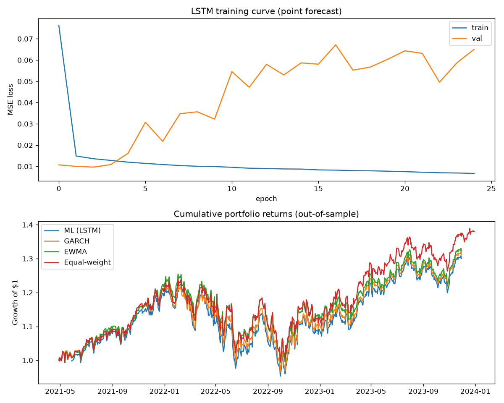

# Volatility Forecasting & Risk-Aware Portfolio Allocation

This project predicts how risky a stock is likely to be (its volatility),
instead of trying to predict whether the price will go up or down. Those
risk predictions are then used to decide how to split money across a few
different stocks. I picked this angle because it felt more realistic and substantial than a
typical "predict if the stock goes up" project. I'm still figuring out
exactly what kind of role I want to pursue, somewhere in business, but
this was a good way to dig into a real problem instead of just running a
model and calling it done.

## Why volatility instead of price direction?

Predicting whether a stock goes up or down tomorrow is extremely hard,
almost random. This connects to the efficient market hypothesis, which
says stock prices already reflect most available information, so there's
not much of a free, exploitable pattern left in price direction.

Volatility is different. It's a lot easier to predict than direction,
because calm periods tend to stay calm and volatile periods tend to stay
volatile. This is called volatility clustering, and older statistical
models (GARCH and EWMA) already capture it reasonably well.

So the real question wasn't "can a machine learning model predict
volatility at all" (yes, fairly trivially, since volatility is
predictable in general). The real question was: can an LSTM (a type of
neural network) actually beat those simpler, established models, and can
its risk estimates be trusted enough to use? I tried to answer that
honestly, including the parts where the answer turned out to be "not
really" or "only sometimes."

## Project structure

```
data_pipeline.py     # loads stock price data via yfinance and builds the input features
baseline_models.py   # the two classical volatility models: EWMA and GARCH
ml_model.py          # LSTM models: one predicts volatility, another predicts a
                      #   "worst case" return (used for VaR, explained below)
backtest.py          # turns predictions into a portfolio and simulates performance
evaluate.py          # checks how accurate the predictions actually were
                      #   (RMSE, QLIKE, correlation, and VaR calibration)
main.py              # runs the full pipeline end to end
```

## Setup

```bash
pip install torch arch scikit-learn matplotlib yfinance pandas numpy
```

## Usage

```bash
python main.py --tickers AAPL MSFT JPM XOM PG --start 2015-01-01 --end 2024-01-01

# Add --save to write results.png, per-ticker PNGs, and CSV files to disk
# instead of just opening chart windows
python main.py --tickers AAPL MSFT JPM XOM PG --start 2015-01-01 --end 2024-01-01 --save

# Training uses a fixed random seed (42) so repeated runs give the same
# numbers. Use --seed to try a different one.
python main.py --tickers AAPL MSFT JPM XOM PG --seed 7
```

Requires an internet connection, since all price data is pulled live from
Yahoo Finance via yfinance.

By default, charts open in interactive windows and nothing gets saved.
Close the windows when you're done looking and the program ends with
nothing left behind in the folder. Add `--save` if you want `results.png`,
the per-ticker PNGs, and `forecast_leaderboard.csv` /
`regime_breakdown.csv` actually written to disk.



## How it actually works

**Two different things are being predicted, on purpose.** One target is
the stock's volatility over the next few weeks, which gets compared
against the GARCH/EWMA formulas. The other target is literally tomorrow's
return, used to build VaR (Value at Risk), an estimate of how bad
tomorrow could realistically get. Early on I mixed these two up (used the
wrong target for VaR) and had to fix it, since predicting "volatility
will be low" isn't the same as predicting "there's only a 5% chance of a
big loss tomorrow."

**No peeking at the future.** With time-based data like stock prices,
it's easy to accidentally let a model see information from the future
during training, which makes results look better than they really are.
Training data always comes strictly before test data here, with no
shuffling across time.

**The "risk warning" gets checked, not just trusted.** If a model says
there's only a 5% chance of a bad day tomorrow, that claim should
actually hold up about 5% of the time when checked against real history.
`evaluate.var_calibration` checks exactly that. Sometimes it held up,
sometimes it didn't, and both outcomes are reported honestly below rather
than only showing the good runs.

**The predictions get turned into an actual portfolio, with realistic
friction.** Once there's a risk prediction, it's used to decide how much
money goes into each stock (less money into whatever looks riskier).
Trading costs are included, and trades only use information from the
previous day, since acting on same-day information isn't realistic.

## What I actually found on real data

**Note:** the numbers in this section came from a run made before I fixed
a bug in the GARCH baseline (see "GARCH bug I found later" below). The
GARCH comparison here is unfair to GARCH, and I still need to re-run it.
The portfolio findings use the same forecasts, so they should be
re-checked too.

**Setup:** 5 major US banks (JPM, BAC, WFC, GS, MS), pulling data from
2018 to 2024. Testing was done on data from March 2022 to November 2023,
which the model hadn't seen during training.

**Which model predicted volatility best (before the GARCH fix):** The LSTM won clearly. It beat
both GARCH and EWMA on accuracy for all 5 stocks, and this held up
across multiple runs.

**Was the VaR estimate actually trustworthy:** Mixed. In one run, only 1
of the 5 banks had a well-calibrated VaR estimate. The other 4 were too
cautious, meaning the model claimed a 5% chance of a bad day when the
real chance was closer to 1 to 3%. This likely happened because the model
was made simpler to stop it from overfitting (more on that below), which
may have also made it overly conservative. I didn't fully solve this, and
I'm noting it here instead of leaving it out.

**Did the better predictions lead to a better portfolio? No, and this was
the most interesting part.** Even though the LSTM was the most accurate
at predicting volatility, using those predictions to build a portfolio
actually did worse than simply splitting money equally across all 5
banks. My first guess was that this "risk parity" strategy (which shifts
money away from whatever looks risky) was failing specifically during the
2023 banking crisis, since banks became highly correlated and crashed
together. I tested that guess directly by breaking the results into three
time periods:

| Time period | LSTM | GARCH | EWMA | Equal split |
|---|---|---|---|---|
| 2022 rate-hike selloff | -1.01 | -1.08 | -1.10 | -1.16 |
| 2023 banking crisis | -2.20 | -2.16 | -2.24 | -2.17 |
| Recovery after | 0.81 | 0.82 | 0.86 | **1.68** |

(These are Sharpe ratios, roughly return per unit of risk taken. Higher
is better.)

That first guess turned out to be wrong. During the actual crisis, every
strategy performed about equally badly, so risk parity wasn't uniquely
failing there. The real gap showed up afterward, during the recovery.
Splitting money evenly did far better during the bounce back (+34%
annualized) than any of the volatility-driven strategies (+16 to 17%).

**Why that happens:** risk parity keeps pulling money away from whatever
looks riskiest at a given moment. Right after a crash, the stocks that
look riskiest are usually the ones that fell hardest, and those are often
exactly the stocks that bounce back hardest too. Risk parity ends up
staying underweight in the stocks that end up leading the recovery.

**Takeaway:** a more accurate volatility forecast didn't translate into a
better investment outcome here. The problem wasn't that risk parity
handled the crash poorly (every strategy did poorly then). It's that risk
parity's core rule, avoid what looks risky, works against it once the
market starts recovering. A natural next step would be having the
strategy relax its risk-avoidance once a crisis looks like it's ending,
instead of applying the same rule regardless of market conditions.

## GARCH bug I found later

The GARCH baseline was only supposed to re-estimate its settings every 21
days, to save time. But the way I wrote it, the forecast itself also
froze for those 21 days. It ignored every new day of returns until the
next refit, so the GARCH line was a staircase instead of reacting day to
day. EWMA did not have this problem. Since the LSTM was compared against
a handicapped GARCH, its win over GARCH was probably bigger than it should
have been.

The fix keeps the 21-day refit, but feeds each new day's return through
the already-fitted model, so the forecast updates every day. I checked it
on simulated data: before, 164 daily forecasts had only 8 different
values. After the fix, all 164 are different, and on refit days the
number is the same as before.

## Why the LSTM forecast looks "flat"

On every ticker I tried, the LSTM forecast moves in a narrow band while
realized volatility swings a lot more, and EWMA and GARCH visibly follow
the swings better. I spent some time trying to fix this. Here is what I
found, using simulated stock data where I know exactly how volatility
behaves (5 stocks, about 6 years, 3 random seeds each):

| What I changed | Correlation with realized vol (avg) |
|---|---|
| Nothing (current model) | 0.69 |
| Longer input window (63 days instead of 21) | 0.61 |
| Predicting log volatility instead | 0.68 |
| Also feeding in raw daily returns | 0.69 |
| Waiting longer before early stopping | 0.68 |
| EWMA, for comparison | 0.72 |
| GARCH (fixed), for comparison | 0.71 |

Earlier I had also tried a bigger model and less weight decay, and those
did not help either. None of these changes made a real difference, and
the longer window made it worse.

The main clue: in every single test, the model did best on the
validation data after only 1 to 4 passes through the training data.
When I let it keep training, it got clearly worse (correlation dropped to
about 0.3 to 0.5). So the model learns the useful pattern almost right
away and then starts memorizing noise. With only a few years of daily
data, and with the 21-day targets overlapping heavily from one day to the
next, there just isn't much independent data to learn from.

Some flatness is also expected for any honest forecast. Part of realized
volatility is pure luck, which nobody can predict, so a good forecast
should swing less than what actually happens. In the simulated data, even
a "perfect" forecaster that knew the true underlying volatility only
swung about 85 to 93% as much as realized volatility. The LSTM swings
about 60 to 75% as much, so it is flatter than ideal, but not as broken
as it first looked.

My conclusion for now: this is a limit of how much data the model gets,
not a setting I forgot to tune. More history (or more tickers trained
together) is the most likely way to help.

## Known limitations

- GARCH re-estimates its settings every 21 days instead of daily, mainly
  because that step is slow. Its forecast still updates every day (see
  the bug section above).
- The correlation estimate used for the min-variance alternative (also in
  `backtest.py`) is a simplified shrinkage approach. Real risk teams
  typically use more sophisticated techniques.
- This was only tested on one time window, and a 5% "bad day" is
  inherently rare, so the calibration numbers are based on a fairly small
  sample. They're best treated as a rough signal, not a precise
  statistical test.
- The LSTM forecast is flatter than it should be (see the section above).
- Training now uses a fixed random seed, so a single run is repeatable.
  But a different seed can still give noticeably different numbers, so
  it's worth checking a few seeds before trusting a small improvement.

## What I'd add next

- More input features (sector info, momentum) instead of treating each
  stock in isolation.
- A GARCH variant that accounts for volatility reacting differently to
  drops versus gains.
- Multiple VaR quantiles instead of a single cutoff, to get a fuller
  picture of the risk distribution.
- Testing this same setup across other historical rough patches (like the
  2020 COVID crash) to see if the recovery-lag pattern found here shows
  up again, or if it was specific to this one banking crisis.
